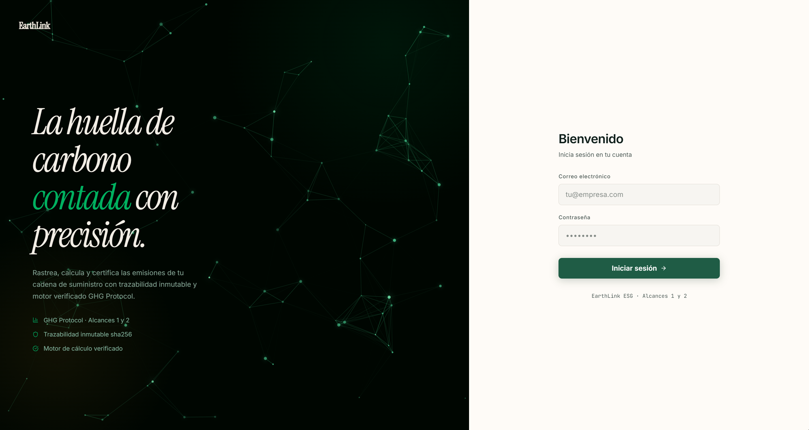
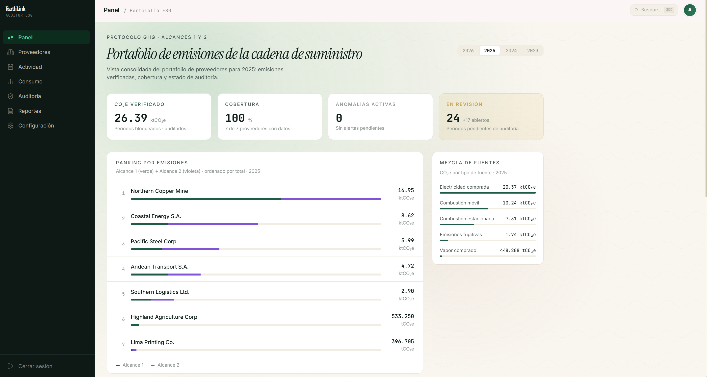
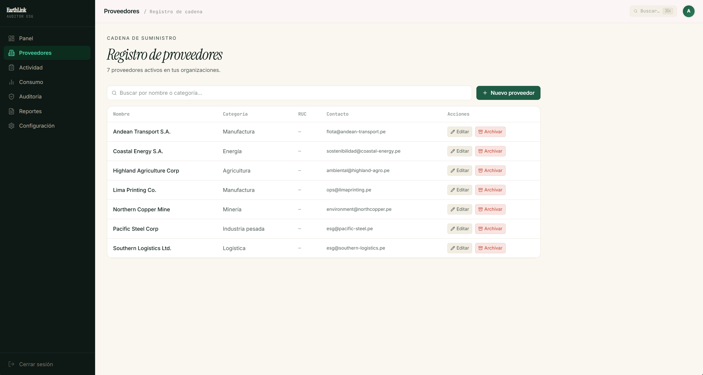
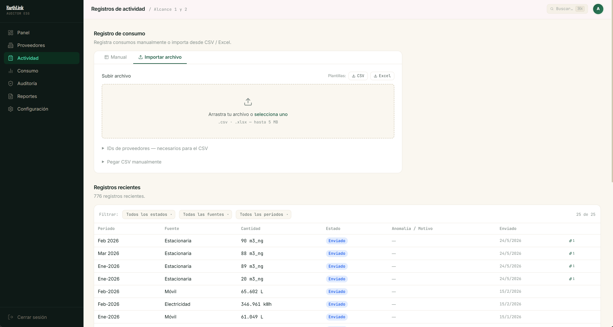
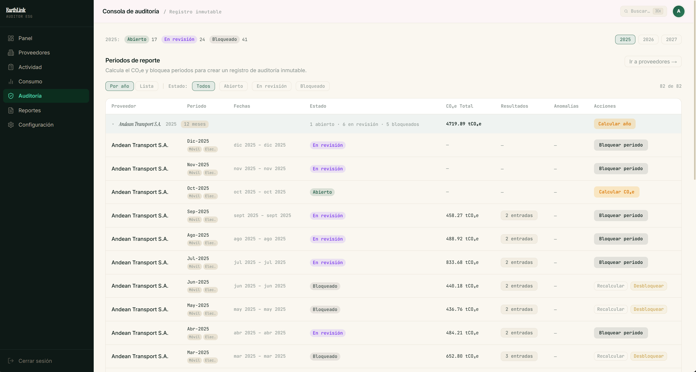
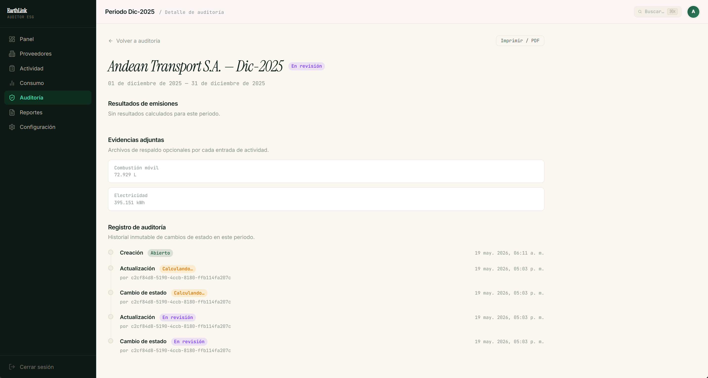
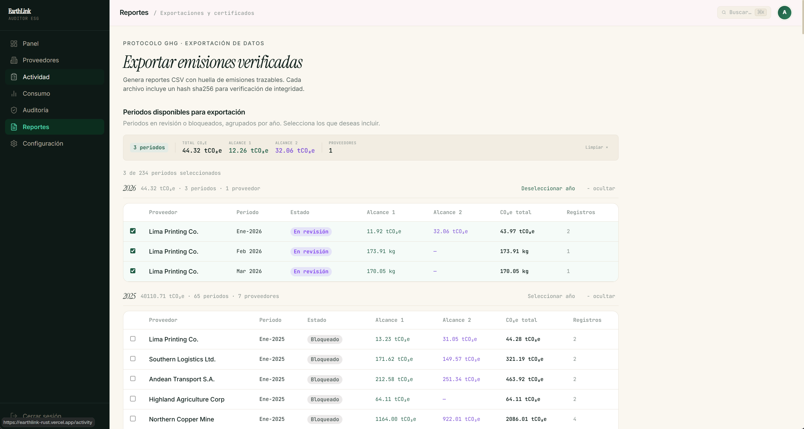

# EarthLink Platform

[](https://github.com/Ferinjoque/earthlink-platform/actions/workflows/main-gate.yml)


[](LICENSE)

---

> **Academic project — important notice**
>
> EarthLink Platform is a portfolio project developed exclusively for learning and technical
> demonstration purposes. It does not represent a real commercial product or a production system.
>
> **No affiliation with existing brands.** The name "EarthLink" is used solely as a fictional
> name for this project. There is no relationship, association, or connection with any company,
> product, or registered trademark that may carry that name.
>
> **No connection to any sustainability platform, company, or service.** This project is not
> affiliated with any existing sustainability organization, product, or solution. All
> functionality, domain design, and sample data are entirely fictional.
>
> Commercial use of this project is not permitted. See [LICENSE](LICENSE).

---

Multi-tenant SaaS platform for Scope 1 and Scope 2 greenhouse gas (GHG) accounting under
the GHG Protocol. Replaces manual spreadsheet tracking with an audited, immutable ledger:
every tCO₂e reported is traceable back to the raw input, the versioned emission factor, the
calculation engine version, and the submitting user.

**Live demo:** [earthlink-rust.vercel.app](https://earthlink-rust.vercel.app)

---

## Screenshots

### Login



---

### Dashboard



---

### Suppliers



---

### Activity



---

### Audit Console



---

### Period Detail



---

### Reports



---

## What it does

- Suppliers submit consumption data (fuels, electricity, water) via a guided form or
  CSV / Excel bulk import.
- A pure functional calculation engine converts raw data to tCO₂e using versioned emission
  factors and fixed-point arithmetic.
- Consultants and administrators review results, manage statistical anomalies, and lock
  periods for immutable record-keeping.
- Locked periods generate exportable reports with SHA-256 hashes for full traceability.

---

## Architecture

The system deliberately separates two programming paradigms:

```
src/app/          Next.js App Router (thin layer)
  |
services/         OOP  — orchestration services
  +---> repos/    OOP  — abstract Repository<T> + Supabase implementations
  |      +---> Supabase (Postgres + RLS + Storage)
  +---> calc/     Pure FP — no side effects, no I/O
domain/           OOP  — EmissionSource hierarchy, value objects
```

### OOP layer (`domain/`, `repos/`, `services/`)

- `abstract EmissionSource` with concrete implementations:
  `StationaryCombustionSource`, `MobileCombustionSource`,
  `PurchasedElectricitySource`, `PurchasedSteamSource`, `FugitiveEmissionSource`.
- `abstract Repository<TEntity>` with `SupabaseRepository<T>` and `InMemoryRepository<T>`
  (used in tests).
- Polymorphism: `source.validate(raw)` and `source.factorKey()` without type switching.

### FP engine (`calc/`)

- Discriminated union `ActivityKind` covers all Scope 1 and 2 activity types.
- Pure pipeline: `validateActivity → normalizeUnit → resolveFactor → applyFactor → stampProvenance`.
- Determinism: fixed-point arithmetic with `big.js`, single rounding at the end,
  calculation hash `sha256(canonical(inputs))`.

---

## Database

15 tables in 4 groups:

| Group | Tables |
|---|---|
| Reference (5) | `fuel_types`, `refrigerants`, `grid_regions`, `emission_factors`, `unit_conversions` |
| Access (3) | `organizations`, `suppliers`, `memberships` |
| Transactional (5) | `reporting_periods`, `activity_entries`, `emission_results`*, `evidence_files`, `anomaly_flags` |
| Audit (2) | `audit_log`*, `report_exports`* |

\* Append-only: database triggers block `UPDATE` and `DELETE` to guarantee immutability of
the audited record.

---

## Tech stack

| Component | Technology |
|---|---|
| Framework | Next.js 16 (App Router) + React 19 |
| Language | TypeScript 5 (strict + `noUncheckedIndexedAccess`) |
| Database | Supabase (Postgres + Auth + RLS) |
| Styles | CSS custom properties with OKLCH tokens |
| Animations | Framer Motion + canvas `requestAnimationFrame` |
| Validation | Zod (inside Server Actions) |
| Arithmetic | `big.js` (fixed-point, 6 decimal places) |
| Unit tests | Vitest |
| E2E tests | Playwright (Chromium + Firefox + WebKit) |
| CI | GitHub Actions |
| Deploy | Vercel + Supabase |

---

## Quick start

```bash
# Requirements: Node 20+, npm or pnpm

npm install
cp .env.example .env.local
# Fill in NEXT_PUBLIC_SUPABASE_URL, NEXT_PUBLIC_SUPABASE_ANON_KEY, SUPABASE_SERVICE_ROLE_KEY

# Apply migrations
npx supabase db push

# Dev server
npm run dev   # http://localhost:3000
```

### Demo credentials

```
email:    admin@earthlink.test
password: Earthlink2025!
```

Admin role in both sample organizations (EcoGroup SAC and Andean Mining Corp).

### Available scripts

```bash
npm run dev            # Dev server
npm run build          # Production build
npm test               # Unit tests
npm run test:coverage  # Tests with coverage report
npm run test:e2e       # E2E tests with Playwright
npm run typecheck      # TypeScript check
npm run lint           # ESLint
```

---

## Project structure

```
src/
  calc/           GHG calculation engine — pure FP, no I/O
  domain/         OOP domain entities
  repos/          Supabase and InMemory repositories
  services/       EvaluationService, AuditService, AnomalyService
  actions/        Server Actions with Zod validation
  components/
    shell/        Sidebar, TopBar
    activity/     Form, list, CSV importer, anomaly badge
    audit/        Period actions, locked periods table
    ui/           Button, Card, Badge, YearSelector
  lib/            Utilities (CSV, formatting, reporting periods)
  styles/         tokens.css, typography.css, globals.css
  types/          database.ts (generated by Supabase CLI)
supabase/
  migrations/     Progressive SQL (20 migrations)
```

---

## GHG Protocol scope

- **Scope 1:** Stationary combustion (natural gas, diesel, LPG), mobile combustion
  (fleet), fugitive emissions (refrigerants).
- **Scope 2:** Purchased electricity (location-based), purchased steam.
- **Scope 3:** Explicitly out of scope for this project.

---

## Deploying to Vercel

1. Connect the repository in the Vercel dashboard.
2. Set the environment variables (same as in `.env.local`).
3. Vercel auto-detects Next.js. Security headers are defined in `next.config.ts`.

| Variable | Where to find it |
|---|---|
| `NEXT_PUBLIC_SUPABASE_URL` | Supabase → Project Settings → API |
| `NEXT_PUBLIC_SUPABASE_ANON_KEY` | Supabase → Project Settings → API |
| `SUPABASE_SERVICE_ROLE_KEY` | Supabase → Project Settings → API (server only) |

---

## License

[CC BY-NC 4.0](LICENSE) — free for personal and educational use with attribution.
Commercial use requires explicit permission from the author.
