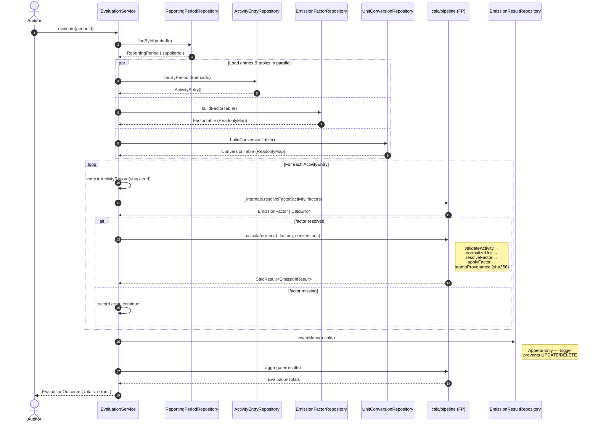
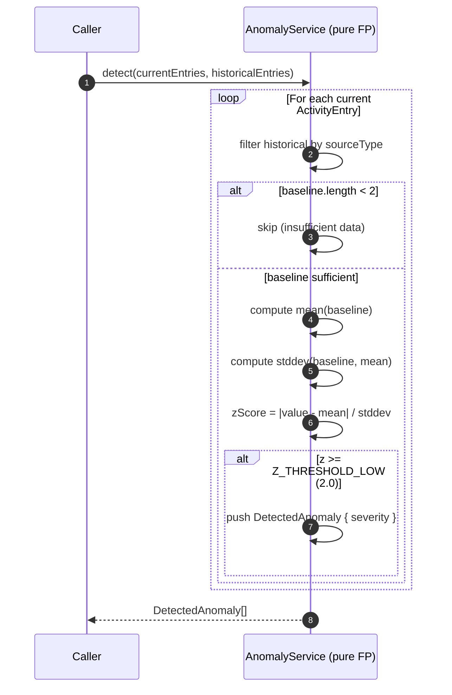

# Evaluation Flow — Sequence Diagram

Shows how `EvaluationService.evaluate()` orchestrates the FP calc engine
and OOP repositories to produce an `EvaluationTotals`.



## Lock Flow (AuditService)

```mermaid
sequenceDiagram
    autonumber
    actor Auditor
    participant AuS as AuditService
    participant RPRepo as ReportingPeriodRepository
    participant ALRepo as AuditLogRepository (append-only)

    Auditor->>AuS: lock(periodId, userId)
    AuS->>RPRepo: findById(periodId)
    RPRepo-->>AuS: ReportingPeriod

    alt period not found
        AuS-->>Auditor: throw Error("not found")
    else period already locked
        AuS-->>Auditor: throw Error("already locked")
    else period is lockable
        AuS->>RPRepo: updateStatus(periodId, "locked")
        RPRepo-->>AuS: ReportingPeriod (locked)
        AuS->>ALRepo: log("LOCK", "reporting_periods", periodId, userId)
        Note right of ALRepo: Immutable row written;<br/>DB trigger prevents mutation
        AuS-->>Auditor: ReportingPeriod (locked)
    end
```

## Anomaly Detection Flow (AnomalyService)


