# EarthLink ESG Auditor — Database Schema (ERD)

15-table relational schema implementing GHG Protocol Scope 1 & 2 accounting.

## Entity-Relationship Diagram

```mermaid
erDiagram
    %% -------------------------------------------------------
    %% Reference Tables
    %% -------------------------------------------------------
    fuel_types {
        uuid   id PK
        text   code UK
        text   label
        int2   scope
        text   activity_kind
    }

    refrigerants {
        uuid    id PK
        text    code UK
        text    label
        numeric gwp_ar6
    }

    grid_regions {
        uuid id PK
        text code UK
        text label
        text country
    }

    emission_factors {
        uuid    id PK
        text    source_type
        uuid    fuel_type_id FK
        uuid    refrigerant_id FK
        uuid    grid_region_id FK
        numeric co2e_per_unit
        text    unit
        int2    scope
        text    source_db
        date    valid_from
        date    valid_to
    }

    unit_conversions {
        uuid    id PK
        text    from_unit
        text    to_unit
        numeric factor
    }

    %% -------------------------------------------------------
    %% Access Tables
    %% -------------------------------------------------------
    organizations {
        uuid id PK
        text name
        text industry
        text ruc
        text country
    }

    suppliers {
        uuid id PK
        uuid organization_id FK
        text name
        text category
        text contact_email
    }

    memberships {
        uuid id PK
        uuid user_id FK
        uuid organization_id FK
        text role
        uuid supplier_id FK
    }

    %% -------------------------------------------------------
    %% Transactional Tables
    %% -------------------------------------------------------
    reporting_periods {
        uuid id PK
        uuid supplier_id FK
        text label
        date start_date
        date end_date
        text status
    }

    activity_entries {
        uuid    id PK
        uuid    reporting_period_id FK
        text    source_type
        jsonb   activity_kind
        numeric raw_quantity
        text    raw_unit
        uuid    fuel_type_id FK
        uuid    refrigerant_id FK
        uuid    grid_region_id FK
        text    status
    }

    emission_results {
        uuid    id PK
        uuid    activity_entry_id FK
        uuid    reporting_period_id FK
        int2    scope
        numeric co2e_kg
        text    calc_hash UK
        text    calc_version
        uuid    emission_factor_id FK
    }

    evidence_files {
        uuid   id PK
        uuid   activity_entry_id FK
        text   storage_path
        text   mime_type
        bigint file_size_bytes
        text   sha256
    }

    anomaly_flags {
        uuid    id PK
        uuid    activity_entry_id FK
        text    detector
        text    severity
        numeric z_score
        boolean is_resolved
    }

    %% -------------------------------------------------------
    %% Audit Tables (append-only)
    %% -------------------------------------------------------
    audit_log {
        uuid        id PK
        text        action
        text        table_name
        uuid        record_id
        jsonb       old_values
        jsonb       new_values
        timestamptz performed_at
    }

    report_exports {
        uuid     id PK
        uuid     organization_id FK
        uuid[]   reporting_period_ids
        text     format
        text     file_sha256
        timestamptz generated_at
    }

    %% -------------------------------------------------------
    %% Relationships
    %% -------------------------------------------------------
    emission_factors }|--o| fuel_types      : "fuel_type_id"
    emission_factors }|--o| refrigerants    : "refrigerant_id"
    emission_factors }|--o| grid_regions    : "grid_region_id"

    organizations    ||--o{ suppliers       : "organization_id"
    organizations    ||--o{ memberships     : "organization_id"
    organizations    ||--o{ report_exports  : "organization_id"

    suppliers        ||--o{ reporting_periods : "supplier_id"
    memberships      }|--o| suppliers        : "supplier_id"

    reporting_periods ||--o{ activity_entries  : "reporting_period_id"
    reporting_periods ||--o{ emission_results  : "reporting_period_id"

    activity_entries ||--o{ emission_results : "activity_entry_id"
    activity_entries ||--o{ evidence_files   : "activity_entry_id"
    activity_entries ||--o{ anomaly_flags    : "activity_entry_id"

    emission_results }|--o| emission_factors : "emission_factor_id"
```

## Table Summary

| # | Table | Category | Rows (seed) | Immutable |
|---|-------|----------|-------------|-----------|
| 1 | `fuel_types` | Reference | 6 | — |
| 2 | `refrigerants` | Reference | 3 | — |
| 3 | `grid_regions` | Reference | 4 | — |
| 4 | `emission_factors` | Reference | 13 | — |
| 5 | `unit_conversions` | Reference | 20 | — |
| 6 | `organizations` | Access | 2 | — |
| 7 | `suppliers` | Access | 6 | — |
| 8 | `memberships` | Access | 0 | — |
| 9 | `reporting_periods` | Transactional | 12 | — |
| 10 | `activity_entries` | Transactional | 10 | — |
| 11 | `emission_results` | Transactional | 6 | **Yes** |
| 12 | `evidence_files` | Transactional | 0 | — |
| 13 | `anomaly_flags` | Transactional | 1 | — |
| 14 | `audit_log` | Audit | 3 | **Yes** |
| 15 | `report_exports` | Audit | 0 | **Yes** |

## Immutability Enforcement

Tables marked **Yes** above have PostgreSQL trigger guards (`fn_prevent_mutation`) that raise
`ERRCODE restrict_violation` on any `UPDATE` or `DELETE`. This is defense-in-depth beyond RLS
since `service_role` bypasses RLS.

## Emission Factors Data Sources

| Source | Version | Tables |
|--------|---------|--------|
| **DEFRA 2024** | UK BEIS Conversion Factors 2024 | `emission_factors` (combustion, electricity) |
| **IPCC AR6** | Sixth Assessment Report, WG1, Annex II | `refrigerants`, `emission_factors` (fugitive) |
| **MINEM 2023** | Peruvian Ministry of Energy — SEIN grid | `emission_factors` (Peru electricity) |

## Planted Demo Anomaly

`anomaly_flags` row `ffffffff-ffff-ffff-ffff-000000000001`:
- Supplier: **Lima Printing & Packaging SAC**, **Q1-2026**
- Activity: diesel stationary combustion, 4,750 L
- Baseline (Q4-2025): 850 L
- z-score: **45.88** (threshold: 3.00)
- Severity: **high** | Detector: `zscore_monthly`
- Likely cause: gallons submitted as litres, or undisclosed equipment change
